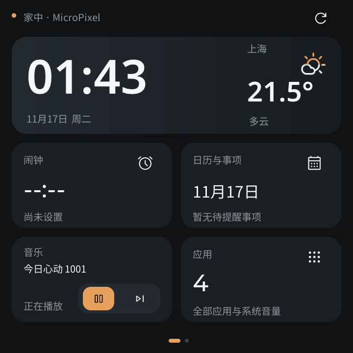
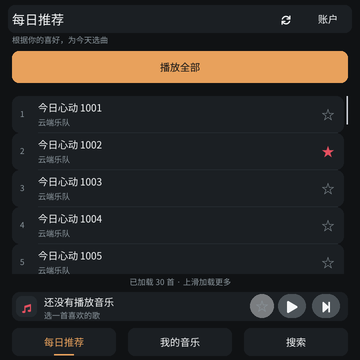
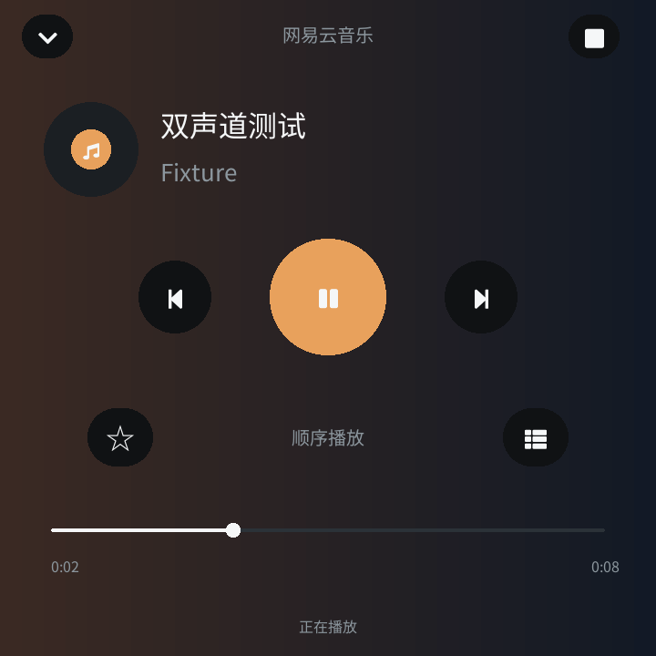
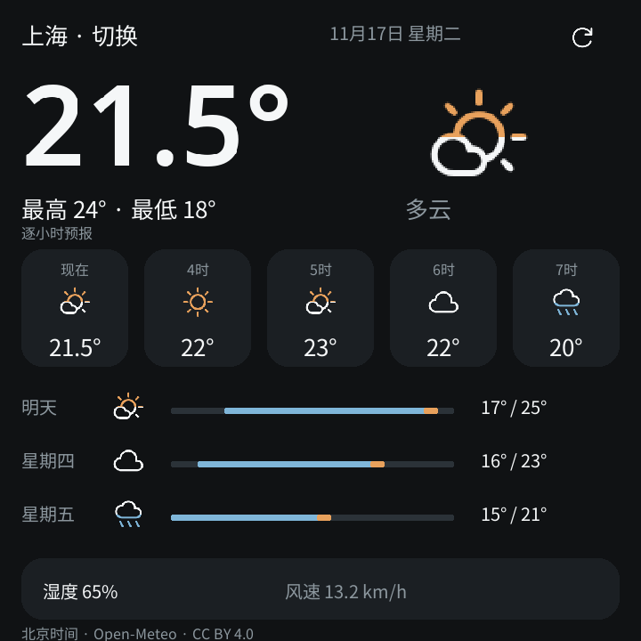
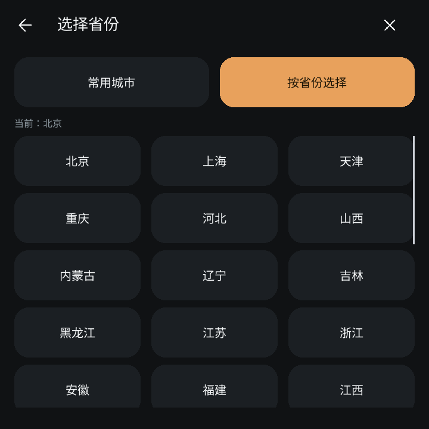
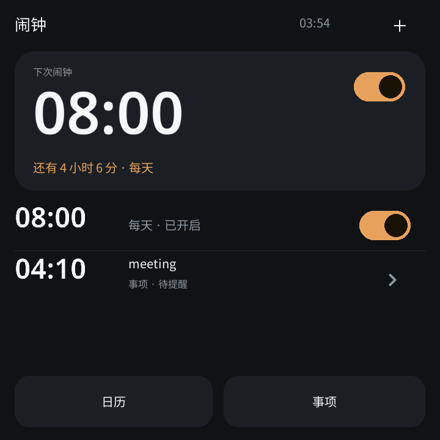
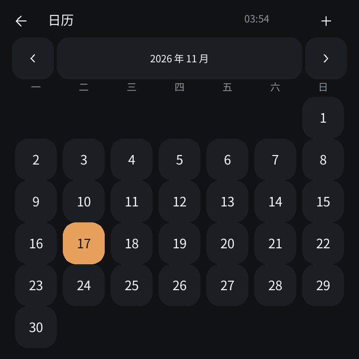
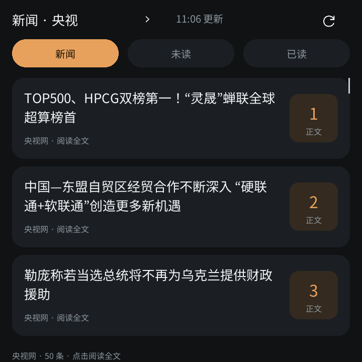
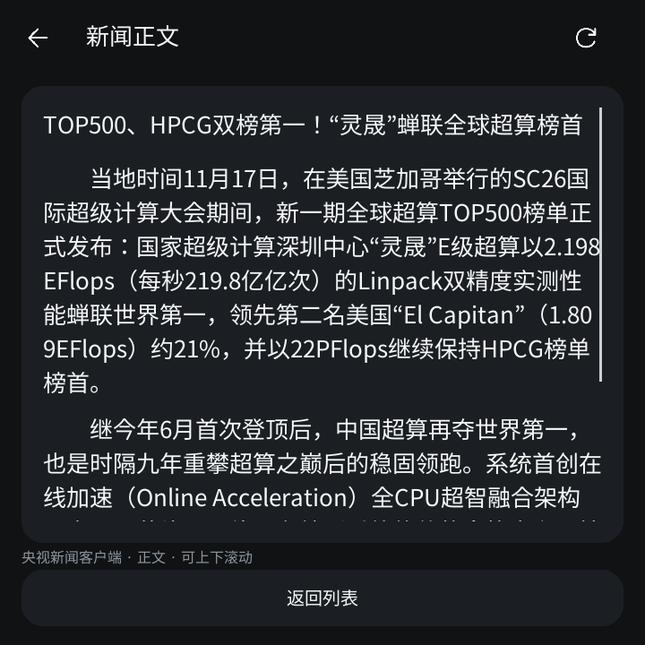

# MicroPixel

[English](README.md) | [简体中文](README.zh-CN.md)

[MicroPixel](https://micropixel.ai) runs WebAssembly apps on Espressif microcontrollers.
Apps use a C++23 SDK for graphics, input, audio, storage, and sensors, without depending on a board-specific SDK.
The firmware manages hardware, app isolation, and the system UI.

This repository also includes a Linux/WSL2 PC Host for developing and running Guest apps without MCU hardware.

## Key additions to the original project

**The central addition is a PC multi-app Home with independently managed Activity / Service lifecycles.**
Switch to weather or news while music keeps playing, then pause or skip from Home. Pages can be destroyed and recreated while the app model retains the account and playback queue.
Host-scheduled jobs refresh weather, and persistent Host alarm plans can ring after the alarm app closes.

| Key addition | What this fork provides |
|---|---|
| Multi-app management and background services | Up to four independent PC App Sessions by default; Activity owns pages and AppService owns background work, with separate component creation, shutdown and resource cleanup. |
| Home and app coordination | Weather, alarms, reminders and music appear on one dashboard; widgets, messages and app activation connect refresh actions, media controls and navigation. |
| Persistent jobs and reminders | The Host manages Job and Alarm plans, wake eligibility and work deadlines for periodic weather updates, durable alarms and reminders. |
| PC development and two execution backends | LVGL + SDL on Linux/WSL2 provides real UI, input, network and audio integration; native Wasm and QEMU RV32 AOT can run as multiple instances or mixed backends. |
| Four default everyday apps | NetEase Cloud Music, weather, alarms/calendar and news cover QR login, network audio, forecasts, reminders and downloaded article reading. |
| Reusable Guest UI components | AppBar, SegmentedControl, VirtualList, ContentStateView and Theme share header layout, list/grid recycling and gesture handling across apps. |

The comparison baseline is the fork point from [the original MicroPixel project](https://github.com/78/micropixel),
[`09833fa`](https://github.com/78/micropixel/commit/09833faa2d5b6b37dcae6781ce13f0948c7a40b3). The MCU Wasm runtime, C++23 SDK, Scene/Service ABI and Bundle model remain the foundation.
These multi-app, background-service and network/media additions currently target and are validated on the PC Host; MCU multi-instance support and the corresponding network/media adapters require separate platform work.

## PC features

| Feature | Available functionality |
|---|---|
| Display and input | LVGL + SDL window, mouse-driven touch and keyboard input, Chinese fonts, and the existing Scene/Raster/Direct Surface services. |
| Home panel | 720×720 design-system panel with a large digital clock, weather, next alarm, Note reminders and music controls. Launch apps and the market; music continues in the background. |
| Official app market | Browse, search, and view releases; download, validate, and install supported official RV32 AOT bundles, then execute them with QEMU. Portable Wasm runs directly in the native WAMR interpreter. |
| NetEase Cloud Music Guest | Direct connection without an API gateway; official website WeChat QR login, account profile and playlists, daily recommendations, search, favorites, scrolling lists, and playback controls. Full playback or previews depend on the server's permissions. |
| News Guest | Direct CCTV news and article downloads with paragraph-aware scrolling, read filters, source selection, retries and offline article cache; retains Toutiao trending topics. |
| Network and audio | POSIX sockets and mbedTLS, asynchronous Guest HTTP/HTTPS, Host MQTT/MQTTS diagnostics, and local/network MP3, WAV, and Ogg/Opus playback through SDL stereo audio. |
| Weather and jobs | Direct Open-Meteo current/hourly/daily weather; 394 city locations in 34 regions, ten popular shortcuts, saved selection and cache; persistent plans and bounded cold/hot work. |
| Calendar and reminders | Month calendar, six editable Note reminders with completion/deletion, persistent one-shot/weekly alarms, ringing after Guest close, modal input and audio ducking. |
| Guest UI SDK | AppBar, SegmentedControl, VirtualList, ContentStateView and Theme, plus IconButton, ListItem, ScrollView and Slider: composite widgets, reusable lists/grids, panel styles, scalable digits, calendar helpers and PNG/JPEG decoding. |

PC Home defaults to four native Wasm slots with weather, clock, music and news; `--single-app` keeps the compatibility profile.
Activity/Service, ownership, widgets, messages, Jobs, alarms and focus use the same SDK. See the
[component contract](docs/design/app-components.zh-CN.md), [D4](docs/development/app-manager-d4.zh-CN.md),
[D5](docs/development/app-manager-d5.zh-CN.md), [D6](docs/development/app-manager-d6.zh-CN.md) and
[D7 guide](docs/development/app-manager-d7.zh-CN.md). RV32 multi-instance and mixed backends are available;
see [D8](docs/development/app-manager-d8.zh-CN.md). MCU multi-instance support remains D9.
The new HTTP and URL audio adapters currently target PC; MCU support requires platform adapters.
The Home, music, weather, news and calendar screens share a dark gray/orange visual style; see the
[panel design](docs/design/panel-ui.zh-CN.md) and [verification guide](docs/development/panel-ui.zh-CN.md).

## Home dashboard

Home is the PC Host's dashboard for time, weather, reminders and music. Open a page from its card and return to the dashboard while music keeps playing in the background.

<p>
  <a href="docs/images/default-apps/home-panel.png"></a>
</p>

*Home: time and weather, reminder cards, music controls and the app launcher (sample data)*

| Area | Display and actions |
|---|---|
| Time and date | Shows the current time and date; select the time area to open alarms. |
| Weather | Shows the selected city, temperature and weather icon; open the forecast or use the top-right button to refresh weather. |
| Alarms / calendar and reminders | Shows the next alarm and upcoming reminder summary; opens the alarm page or month calendar. |
| Music | Shows the current track and playback state; play/pause or skip directly, or select the card to resume the music page. |
| Apps | Opens the app drawer to launch apps such as News, enter the market, adjust system volume or close the current app. |

Press `Esc`, `Home` or `F1` in an app to return to Home. Select the music card or the drawer's Return to app entry to resume the existing instance.
See the [PC Home guide](docs/design/pc-home.zh-CN.md) (Chinese) for navigation and background behavior.

## Default apps and screens

PC Home includes the following four apps. These are actual 720×720 PC Host screenshots: music, weather and reminders use sample data, while news shows public CCTV content. Select an image for the full-size view.

### NetEase Cloud Music

Sign in with the official website's WeChat QR flow to browse playlists, daily recommendations and search results, and favorite songs.
The dedicated player supports play/pause, previous/next and seeking; music keeps playing when you return to Home.
See the [music app guide](guest/apps/netease-music/README.zh-CN.md) (Chinese).

<p>
  <a href="docs/images/default-apps/music-list.png"></a>
  <a href="docs/images/default-apps/music-player.png"></a>
</p>

*Recommendations and favorites · Dedicated player*

### Weather

View current conditions, hourly and three-day forecasts, humidity and wind speed.
Choose from popular shortcuts or 394 locations grouped by region. The app saves your selection and retains the last successful forecast when refresh fails.
See the [weather app guide](guest/apps/weather/README.zh-CN.md) (Chinese).

<p>
  <a href="docs/images/default-apps/weather-forecast.png"></a>
  <a href="docs/images/default-apps/weather-cities.png"></a>
</p>

*Conditions and forecasts · Region and city selection*

### Alarms and calendar

Check the next alarm and reminder summary, configure one-shot or daily alarms, and select dates on the month calendar to add, edit, complete or delete reminders.
The Host saves alarm plans persistently and rings even after the app closes.
See the [calendar and reminders guide](guest/apps/clock-alarm/README.zh-CN.md) (Chinese).

<p>
  <a href="docs/images/default-apps/clock-alarm.png"></a>
  <a href="docs/images/default-apps/clock-calendar.png"></a>
</p>

*Alarms and reminder summary · Month calendar and date selection*

### News

Browse CCTV headlines and select a card to download and scroll through the article. Filter unread/read items, retry failed requests and revisit the most recently cached article.
Select the source in the header to switch to Toutiao trending topics and their popularity scores.
See the [news app guide](guest/apps/news/README.zh-CN.md) (Chinese).

<p>
  <a href="docs/images/default-apps/news-list.png"></a>
  <a href="docs/images/default-apps/news-article.png"></a>
</p>

*CCTV headlines · Article download and reading*

## Run on a PC

Use Ubuntu 22.04 or WSL2 with GUI/audio support. Install WASI SDK, CMake, Ninja, Python 3, and the SDL2,
libpng, and cJSON development packages; see the [PC setup guide](firmware/pc/README.zh-CN.md) (Chinese).
From the repository root:

```sh
bash tools/pc.sh deps
bash tools/pc.sh configure
bash tools/pc.sh build
bash tools/pc.sh run --home
# RV32 instances: builds the runner and four SDK AOT bundles.
bash tools/pc.sh run --home --rv32

# Open the official market or the music login screen.
bash tools/pc.sh run --market
bash tools/pc.sh run --music-login
```

`--home` builds the weather, clock, music and news Guests; music commands build the music Guest. Press `Home` or `F1` to return
to Home while keeping it running. `Esc` also returns to Home with background playback; the app drawer's Close button stops the current app.
Official RV32 AOT apps additionally require `qemu-system-riscv32` and a bare-metal GCC with
`rv32imafc/ilp32f` Newlib support. Run `bash tools/pc.sh rv32-build` before installing them from the market.
Xtensa AOT and Wi-Fi hardware emulation are not supported. Audio files are downloaded before playback.

See [PC Home](docs/design/pc-home.zh-CN.md), [RV32 execution](docs/design/pc-rv32.zh-CN.md),
and the [music Guest guide](guest/apps/netease-music/README.zh-CN.md) for details (Chinese).

## Hardware

| Chip | Board |
|---|---|
| ESP32-P4 | [Metalio-Claw4](https://github.com/CloudZao/MetalioClaw4) |
| ESP32-P4 | [KSDIY ESP32-P4C5 4.3"](https://github.com/kevincoooool/ESP32P4_KSDIY) |
| ESP32-S31 | [ESP-Mosaico](https://github.com/esp-mosaico/esp-mosaico-bsp) |
| ESP32-S3 | [ESP32-S3-BOX-3](https://github.com/espressif/esp-box) |
| ESP32-S3 | [LCKFB SZPI](https://wiki.lckfb.com/zh-hans/szpi-esp32s3/beginner/introduction.html) |
| ESP32-S3 | [M5Stack CoreS3](https://docs.m5stack.com/en/core/CoreS3) |
| ESP32-S3 | [SenseCAP Watcher](https://wiki.seeedstudio.com/cn/getting_started_with_watcher/) |

The Host uses ESP-IDF 6.1 and a pinned [WAMR fork](https://github.com/78/wasm-micro-runtime).
MCU apps are compiled to architecture-specific AOT v6 bundles. The ABI is still evolving.

## Build an app

Install the [SDK](https://micropixel.ai/docs/environment/) and connect a device running MicroPixel firmware.
App development does not require ESP-IDF.

```sh
micropixel init my-app --app-id com.example.my-app --title "My App"
cd my-app
micropixel --transport usb run
```

`run` builds, installs, starts the app, and follows its logs. Ctrl-C stops log streaming; the app keeps running.
See the [quickstart](guest/sdk/QUICKSTART.md) and [publishing guide](guest/sdk/PUBLISHING.md).

## Build the firmware

Initialize submodules, activate ESP-IDF 6.1, and configure WASI SDK and the matching MicroPixel WAMRC.
See the [build guide](docs/development/flashing.zh-CN.md) (Chinese) for toolchain setup and flashing.

```sh
git submodule update --init --recursive
python3 -m pip install -r requirements-dev.txt
bash tools/p4.sh build-host
```

Other profiles: `bash tools/s31.sh build-host`, `bash tools/s3.sh build-host <box3|szpi|cores3|watcher>` and
`python3 tools/firmware.py <ksdiy-p4c5|ksdiy-p4c5-landscape> build`.

## Project

- [Guest SDK](guest/sdk/README.md) — app APIs and examples.
- [Firmware](firmware/README.md) — Host runtime and board support.
- [Documentation](docs/README.md) — architecture, protocols, and development guides.
- [Contributing](CONTRIBUTING.md).

## License

Project-authored code, documentation, and assets use [Apache-2.0](LICENSE), unless stated otherwise.
See [third-party notices](THIRD_PARTY_NOTICES.md) for dependency licenses and exceptions.
