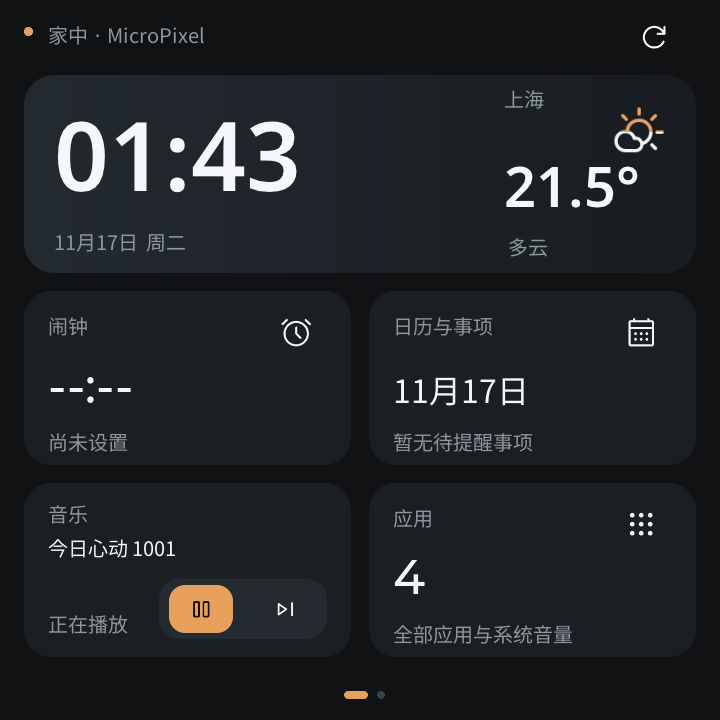
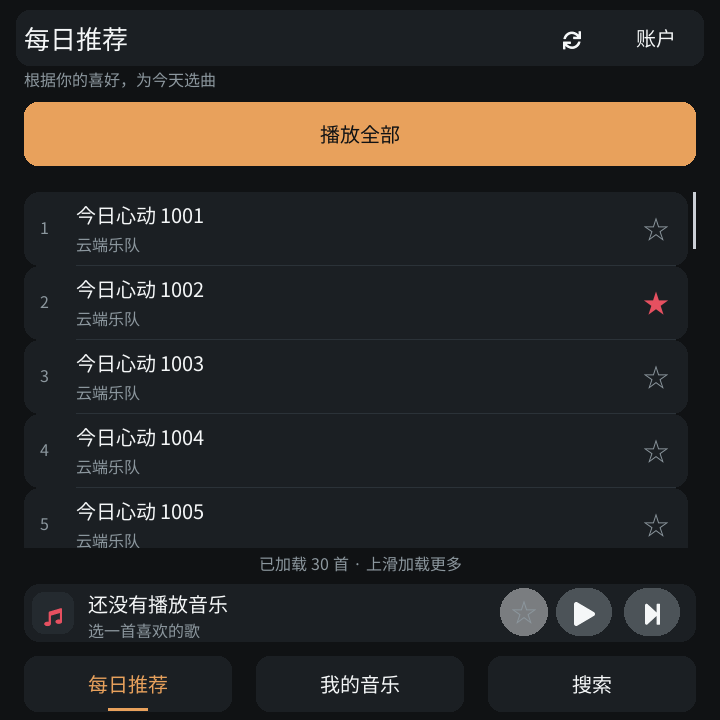
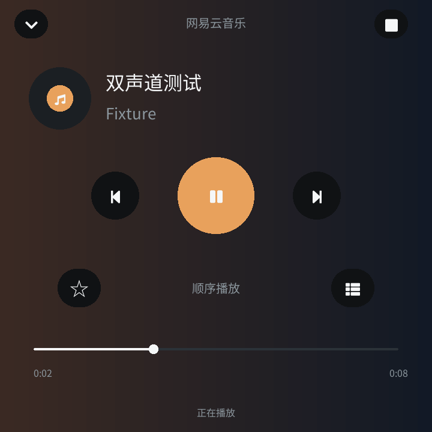
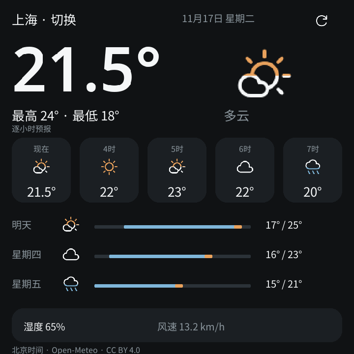
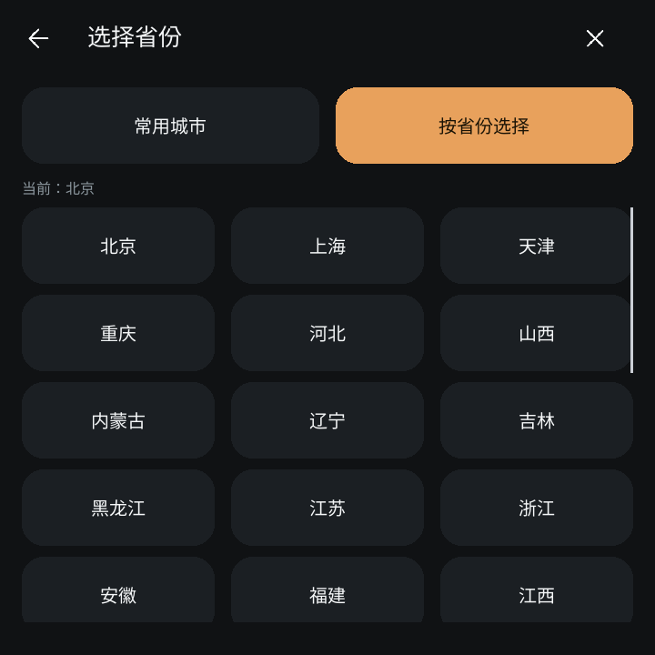
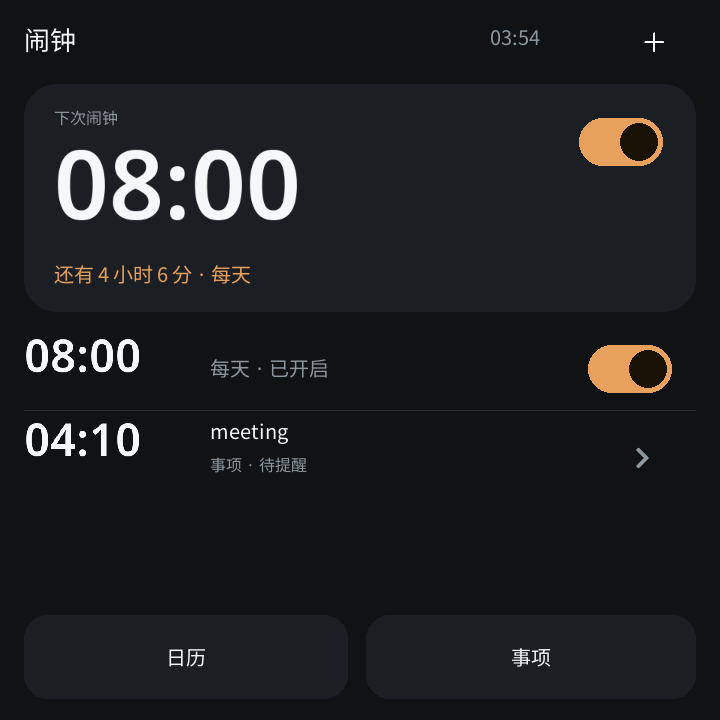
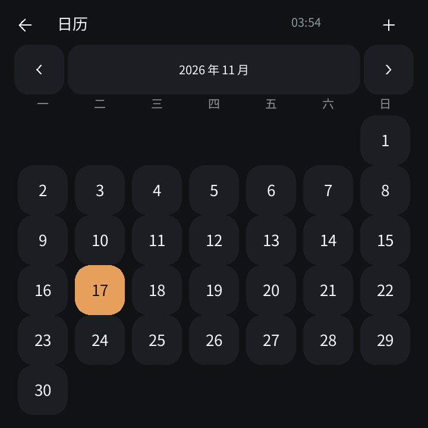
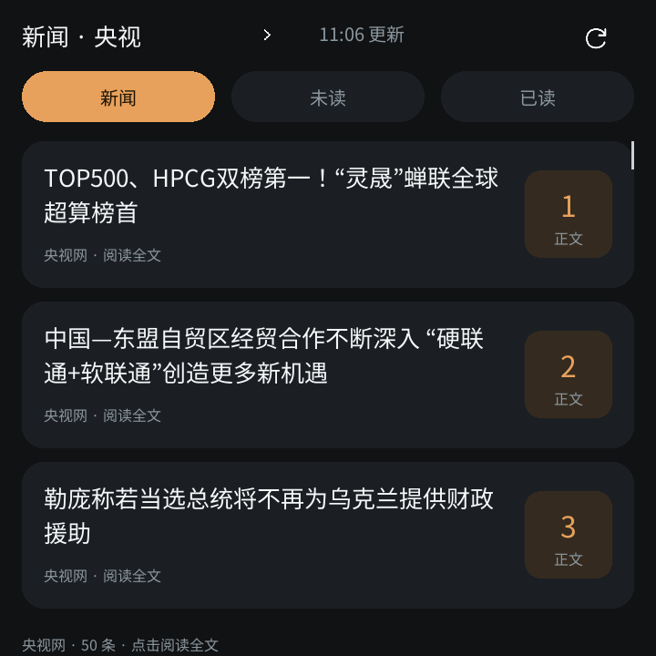
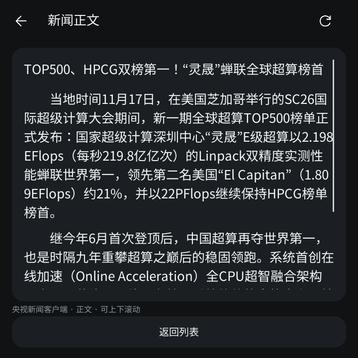

# MicroPixel

[English](README.md) | [简体中文](README.zh-CN.md)

[MicroPixel](https://micropixel.ai) 是 Espressif 微控制器上的 WebAssembly 应用运行时。
应用通过 C++23 SDK 使用图形、输入、音频、存储和传感器，无需依赖板级 SDK。
固件负责硬件管理、应用隔离和系统界面。

本仓库同时提供 Linux/WSL2 PC Host，可在没有 MCU 硬件时开发和运行 Guest 应用。

## PC 新增功能

| 功能 | 已支持的能力 |
|---|---|
| 显示与输入 | LVGL + SDL 窗口、鼠标模拟触摸和键盘输入、中文字体，复用 Scene/Raster/Direct Surface 服务。 |
| Home 面板 | 依据 720×720 设计稿，显示数字时钟、天气、下一次闹钟、Note 事项与音乐播控；支持应用目录和市场，音乐后台继续播放。 |
| 官方应用市场 | 浏览、搜索和查看版本，下载校验并安装支持的官方 RV32 AOT Bundle，由 QEMU 执行；portable Wasm 直接由本机 WAMR 解释执行。 |
| 网易云音乐 Guest | 无 API 网关直连，支持官网微信扫码登录、个人资料与歌单、每日推荐、搜索、红星收藏、滚动列表与播放控制；完整播放或试听以服务端权限为准。 |
| 新闻 Guest | 默认直连央视新闻，下载正文、保留段落并滚动阅读；未读/已读、来源切换、重试与正文缓存，同时保留今日头条热榜。 |
| 网络与音频 | POSIX socket、mbedTLS、Guest 异步 HTTP/HTTPS、Host MQTT/MQTTS 连通性测试，以及本地／网络 MP3、WAV、Ogg/Opus 文件的 SDL 立体声播放。 |
| 天气与后台任务 | Open-Meteo 直连，当前/小时/三日预报；34 省区 394 城市地区、10 个常用城市、选择与天气缓存；持久 Job、有限工作票据及冷/热/挂起唤醒。 |
| 日历与提醒 | 月历、六条可编辑/完成/删除的 Note 提醒、单次/每周闹钟；Host 持久登记，关闭应用仍响铃，弹窗输入优先并压低音乐音量。 |
| Guest UI SDK | AppBar、SegmentedControl、VirtualList、ContentStateView 与 Theme，配合 IconButton、ListItem、ScrollView、Slider，提供复合控件、列表/网格复用、面板配色、可缩放数字、公历计算及 PNG/JPEG 纹理解码。 |

PC Home 默认四个原生 Wasm 槽，天气、时钟、音乐与新闻共存；`--single-app` 保留单槽兼容路径。
Activity/Service、资源归属、Widget、消息、Job、闹钟与焦点使用同一套 SDK，见
[组件契约](docs/design/app-components.zh-CN.md)、[D4](docs/development/app-manager-d4.zh-CN.md)、
[D5](docs/development/app-manager-d5.zh-CN.md)、[D6](docs/development/app-manager-d6.zh-CN.md)和
[D7](docs/development/app-manager-d7.zh-CN.md)。RV32 多实例与混合后端已接入，见
[D8](docs/development/app-manager-d8.zh-CN.md)；MCU 多实例留在 D9。
新增 HTTP 与 URL 音频适配器目前用于 PC，MCU 需要补齐对应平台适配。
Home、音乐、天气、新闻和日历使用统一的深灰与橙色控件，详见
[面板界面设计](docs/design/panel-ui.zh-CN.md)和[运行与验证](docs/development/panel-ui.zh-CN.md)。

## Home 首页

Home 是 PC Host 的统一首页，集中显示时间、天气、提醒和音乐状态。点击卡片进入对应页面，返回首页后音乐继续后台播放。

<p>
  <a href="docs/images/default-apps/home-panel.png"></a>
</p>

*Home 首页：时钟与天气主卡、提醒卡片、音乐播控和应用入口（示例数据）*

| 区域 | 显示与操作 |
|---|---|
| 时间与日期 | 显示当前时间和日期；点击时间区域进入闹钟页。 |
| 天气 | 显示所选城市、温度和天气图标；点击进入详细预报，右上角按钮刷新天气。 |
| 闹钟 / 日历与事项 | 查看下一次闹钟和待提醒事项摘要，分别进入闹钟页或月历。 |
| 音乐 | 显示当前歌曲和播放状态；直接播放/暂停、切换下一首，点击卡片恢复音乐页面。 |
| 应用 | 打开应用目录，启动新闻等 App、进入应用市场、调节系统音量，或关闭当前应用。 |

在 App 中按 `Esc`、`Home` 或 `F1` 返回首页；点击音乐卡片或应用目录中的“返回应用”恢复原实例。
更多导航与后台运行行为见 [PC Home 说明](docs/design/pc-home.zh-CN.md)。

## 默认 App 与页面

从 PC Home 可进入以下四个默认 App。下图为 720×720 PC Host 实际运行截图：音乐、天气和提醒使用示例数据，新闻展示公开的央视内容。点击图片可查看原图。

### 网易云音乐

使用官网微信扫码登录，查看个人歌单、每日推荐和搜索结果，并用红星收藏歌曲。
独立播放页支持播放/暂停、上一首/下一首和拖动进度；返回 Home 后继续后台播放。
详见[音乐应用指南](guest/apps/netease-music/README.zh-CN.md)。

<p>
  <a href="docs/images/default-apps/music-list.png"></a>
  <a href="docs/images/default-apps/music-player.png"></a>
</p>

*每日推荐与收藏 · 独立播放页*

### 天气

查看当前温度、逐小时与未来三日预报，以及湿度和风速。
通过常用城市或省区列表选择全国 394 个城市/地区；选择会保留，刷新失败时继续显示最近成功的天气。
详见[天气应用指南](guest/apps/weather/README.zh-CN.md)。

<p>
  <a href="docs/images/default-apps/weather-forecast.png"></a>
  <a href="docs/images/default-apps/weather-cities.png"></a>
</p>

*天气与预报 · 省区和城市选择*

### 闹钟日历

在闹钟页查看下一次闹钟和事项摘要，设置单次或每天重复的闹钟；在月历上选日，添加、编辑、完成或删除事项。
提醒由 Host 持久保存，关闭 App 后仍可按时响铃。
详见[日历与提醒指南](guest/apps/clock-alarm/README.zh-CN.md)。

<p>
  <a href="docs/images/default-apps/clock-alarm.png"></a>
  <a href="docs/images/default-apps/clock-calendar.png"></a>
</p>

*闹钟与事项摘要 · 月历与日期选择*

### 新闻

默认浏览央视新闻，点击卡片下载正文并上下滚动阅读；支持未读/已读筛选、失败重试和最近文章缓存。
点击顶部来源可切换到今日头条热榜，查看话题标题与热度。
详见[新闻应用指南](guest/apps/news/README.zh-CN.md)。

<p>
  <a href="docs/images/default-apps/news-list.png"></a>
  <a href="docs/images/default-apps/news-article.png"></a>
</p>

*央视新闻列表 · 正文下载与滚动阅读*

## 在 PC 上运行

使用带图形和音频支持的 Ubuntu 22.04 或 WSL2，准备 WASI SDK、CMake、Ninja、Python 3，
以及 SDL2、libpng、cJSON 开发包；依赖安装详见 [PC 运行指南](firmware/pc/README.zh-CN.md)。
在仓库根目录执行：

```sh
bash tools/pc.sh deps
bash tools/pc.sh configure
bash tools/pc.sh build
bash tools/pc.sh run --home
# RV32 多实例，自动构建 runner 和四个新 SDK AOT 包。
bash tools/pc.sh run --home --rv32

# 单独打开官方市场或音乐登录界面。
bash tools/pc.sh run --market
bash tools/pc.sh run --music-login
```

`--home` 会构建天气、时钟、音乐和新闻 Guest；音乐命令自动构建音乐 Guest。按 `Home` 或 `F1` 返回 Home，保留后台运行；
`Esc` 同样返回 Home 并保留后台播放；需要停止应用时点击 应用目录的“关闭当前应用”。
运行官方 RV32 AOT 还需要 `qemu-system-riscv32` 和支持 `rv32imafc/ilp32f` Newlib 的裸机 GCC，
先执行 `bash tools/pc.sh rv32-build`，再从市场安装。当前不支持 Xtensa AOT 或 Wi-Fi 硬件模拟，
音频文件下载完成后播放。

详见 [PC Home](docs/design/pc-home.zh-CN.md)、[RV32 运行方案](docs/design/pc-rv32.zh-CN.md)
和[网易云音乐应用指南](guest/apps/netease-music/README.zh-CN.md)、[新闻应用指南](guest/apps/news/README.zh-CN.md)。

## 支持硬件

| 芯片 | 开发板 |
|---|---|
| ESP32-P4 | [Metalio-Claw4](https://github.com/CloudZao/MetalioClaw4) |
| ESP32-P4 | [酷世DIY ESP32-P4C5 4.3 寸](https://github.com/kevincoooool/ESP32P4_KSDIY) |
| ESP32-S31 | [ESP-Mosaico](https://github.com/esp-mosaico/esp-mosaico-bsp) |
| ESP32-S3 | [ESP32-S3-BOX-3](https://github.com/espressif/esp-box) |
| ESP32-S3 | [立创 SZPI](https://wiki.lckfb.com/zh-hans/szpi-esp32s3/beginner/introduction.html) |
| ESP32-S3 | [M5Stack CoreS3](https://docs.m5stack.com/en/core/CoreS3) |
| ESP32-S3 | [SenseCAP Watcher](https://wiki.seeedstudio.com/cn/getting_started_with_watcher/) |

Host 使用 ESP-IDF 6.1 和固定版本的 [WAMR fork](https://github.com/78/wasm-micro-runtime)。
MCU 应用按目标架构编译为 AOT v6 Bundle，ABI 仍在演进。

## 开发应用

安装 [SDK](https://micropixel.ai/docs/environment/)，连接已运行 MicroPixel 固件的设备。
应用开发不需要 ESP-IDF。

```sh
micropixel init my-app --app-id com.example.my-app --title "My App"
cd my-app
micropixel --transport usb run
```

`run` 构建、安装、启动应用并跟随日志。Ctrl-C 退出日志跟随，应用继续运行。
详见[快速入门](guest/sdk/QUICKSTART.zh-CN.md)与[发布指南](guest/sdk/PUBLISHING.zh-CN.md)。

## 构建固件

初始化子模块，激活 ESP-IDF 6.1，配置 WASI SDK 和匹配的 MicroPixel WAMRC。
工具链安装与烧录步骤见[构建指南](docs/development/flashing.zh-CN.md)。

```sh
git submodule update --init --recursive
python3 -m pip install -r requirements-dev.txt
bash tools/p4.sh build-host
```

其他板型：`bash tools/s31.sh build-host`、`bash tools/s3.sh build-host <box3|szpi|cores3|watcher>`、
`python3 tools/firmware.py <ksdiy-p4c5|ksdiy-p4c5-landscape> build`。

## 项目文档

- [Guest SDK](guest/sdk/README.zh-CN.md)：应用接口与示例。
- [Firmware](firmware/README.zh-CN.md)：Host 运行时与板级支持。
- [文档索引](docs/README.zh-CN.md)：架构、协议与开发指南。
- [参与贡献](CONTRIBUTING.zh-CN.md)。

## 许可证

项目自有代码、文档和素材默认采用 [Apache-2.0](LICENSE)。
依赖许可证与例外见[第三方声明](THIRD_PARTY_NOTICES.md)。
